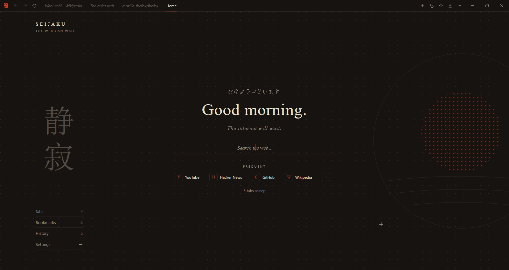
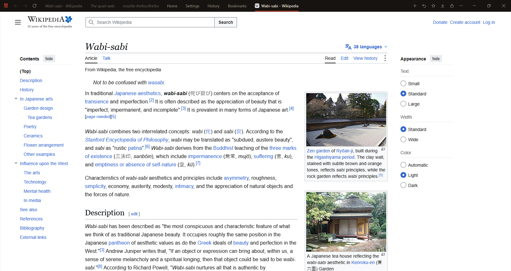
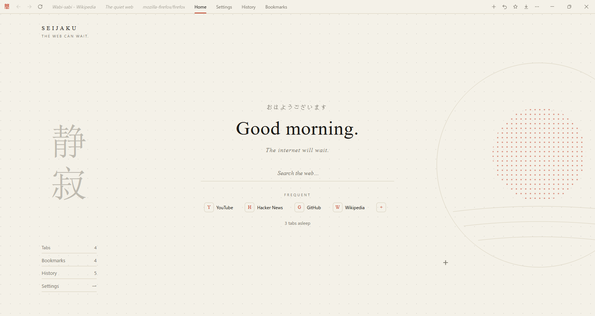
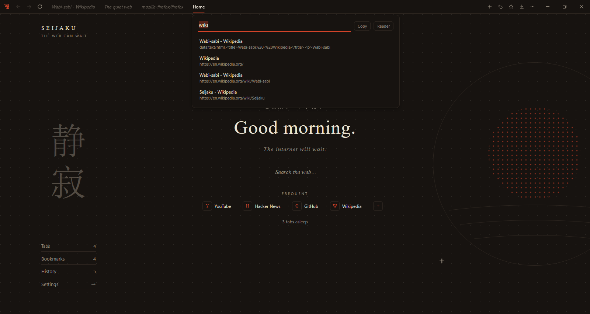
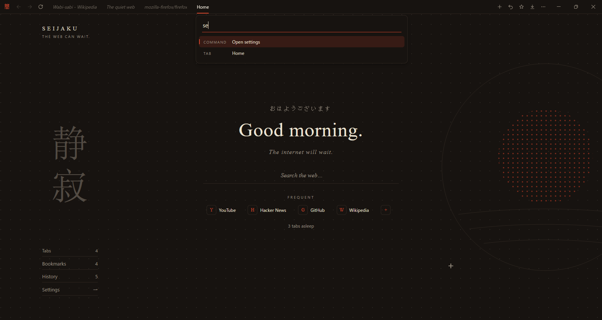
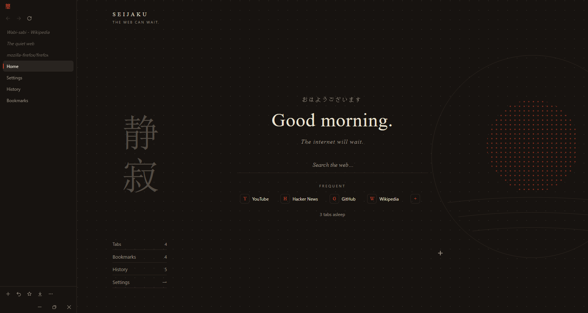
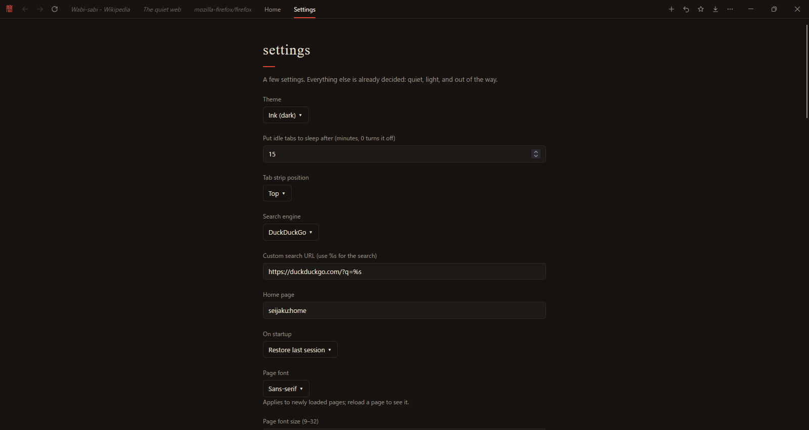

# 静寂 Seijaku

**A quiet web browser for Windows.**
One tab strip, one page, and nothing else in the way.

Free · Open source · Runs on Mozilla's Firefox engine · No admin rights needed

## Why Seijaku

Most browsers fill the window with toolbars, sidebars, news feeds and
sign-in prompts. Seijaku keeps one thin strip at the top and gives the
rest of the screen to the page. The address bar only appears when you
ask for it, and disappears again when you're done.

Under the hood it is the real Firefox engine, unmodified, so sites work
the way they do in Firefox and you get Mozilla's security updates. What
Seijaku leaves out is everything around it that you didn't ask for.

- **Light on your PC.** Tabs you haven't looked at in 15 minutes fall
  asleep and give their memory back. On startup only the tab you're
  looking at loads.
- **Private by default.** No telemetry, no studies, no sponsored
  content, no Pocket, no accounts, no crash uploads. Nothing phones
  home. ([The full list](docs/STRIPPED.md).)
- **Your extensions come along.** Install add-ons straight from
  addons.mozilla.org. uBlock Origin and Bitwarden work, popups and
  passkeys included.
- **Calm to look at.** Two themes, ink (dark) and paper (light), one
  vermilion accent, and a home page that greets you instead of
  advertising at you.

## A look around

<table>
<tr>
<td width="50%"> <b>Pages get the whole window.</b> Just a slim strip of tabs on top.</td>
<td width="50%"> <b>Ink or paper.</b> A dark and a light theme, from Settings or the palette.</td>
</tr>
<tr>
<td> <b>A floating address bar.</b> Ctrl+L or Ctrl+T brings it up. It finds open tabs first, then bookmarks, then history.</td>
<td> <b>A command palette.</b> Ctrl+K to search every command, tab and bookmark.</td>
</tr>
<tr>
<td> <b>Tabs on top or down the side.</b> The strip can also hide itself until you reach for it.</td>
<td> <b>A few settings, not a hundred.</b> Everything else is already decided.</td>
</tr>
</table>

## Everything you need day to day

- **Tabs** that you can drag to reorder, pin, mute, put to sleep, and
  reopen after closing (Ctrl+Shift+T). Site icons beside each name.
- **Bookmarks and history**, with import, folders and search.
- **Private windows** (Ctrl+Shift+N) that keep no history.
- **Reader view** that turns a cluttered article into clean text.
- **A built-in PDF viewer** where you can draw and leave notes, then
  save an annotated copy.
- **Downloads**, **find in page**, **zoom**, **print** and **save page**.
- **Right-click menus** for pages, links, images, video, text and tabs.
- **Full-screen video**, mouse back and forward buttons, and
  middle-click to open links in a new tab.
- **Automatic updates.** Seijaku checks GitHub once a day, downloads a
  new version in the background and installs it when you quit.

## Install it

1. Go to the [latest release](https://github.com/tacobellerontop-sudo/seijaku_/releases/latest).
2. Download **SeijakuSetup** and run it.

That's it. It installs for your Windows account only, needs no admin
rights, and doesn't need Firefox installed first.

Prefer no installer? Download the **portable zip** from the same page,
unzip it anywhere and run `Seijaku.bat`. Your
profile stays in the folder next to it. See
[docs/INSTALLER.md](docs/INSTALLER.md) for what the installer does and
where your profile lives.

Requires 64-bit Windows 10 or 11.

## Handy keys

| Keys | What it does |
| --- | --- |
| `Ctrl+T` | New tab, with the address bar open |
| `Ctrl+L` | Address bar for this tab |
| `Ctrl+K` | Command palette |
| `Ctrl+W` | Close tab (or double-click it) |
| `Ctrl+Shift+T` | Reopen a closed tab |
| `Ctrl+Shift+N` | Private window |
| `Ctrl+D` | Bookmark this page |
| `Ctrl+Shift+H` | Hide or show the tab strip |
| `Ctrl+,` | Settings |

Settings lists every shortcut.

## Build it

Releases are built by the Release workflow in GitHub Actions: it
downloads Firefox, wraps the shell around the engine, and publishes
the installer and the portable zip. See [docs/PLAN.md](docs/PLAN.md)
for the design, and [docs/releases](docs/releases) for what changed in
each version. Screenshots in this README come from the Screenshots
workflow, which runs Seijaku on a real Windows machine.

## Licence

Mozilla Public License 2.0, see [LICENSE](LICENSE). Firefox's engine,
which Seijaku runs on, is Mozilla's and under the same licence.
